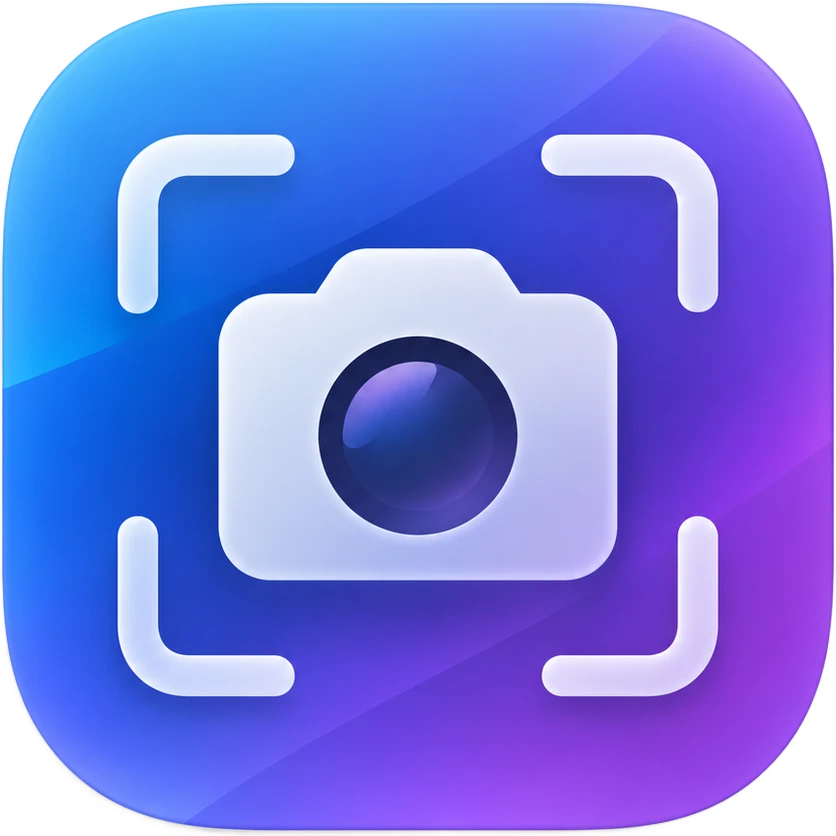

<p align="center">
  
</p>

<h1 align="center">Screenshoter</h1>

<p align="center">
  Легкий скріншотер для macOS: гаряча клавіша → знімок одразу в буфер обміну.<br>
  <a href="#english">English below</a>
</p>

## Можливості

- **⌥⇧S** — виділити область мишкою (Пробіл — вибрати вікно, Esc — скасувати)
- **⌥⇧A** — весь екран
- Знімок одразу в буфері обміну — просто **⌘V** куди завгодно, без файлів на диску
- Свої комбінації клавіш у налаштуваннях
- Мова інтерфейсу: українська / English
- Можна сховати іконку з рядка меню
- Автозапуск при вході в систему
- Автооновлення з GitHub з перевіркою цифрового підпису (з версії 1.1.0)
- Займає ~24 МБ пам'яті, 0% процесора у фоні
- Універсальна програма: Apple Silicon та Intel

## Встановлення

1. Завантажте `Screenshoter-<версія>.pkg` зі сторінки [Releases](https://github.com/istvikoo/Screenshoter/releases).
2. Відкрийте його й натисніть «Встановити» — програма з'явиться в «Програмах» і запуститься.
3. При першому знімку дозвольте **запис екрана**: Системні параметри → Конфіденційність і безпека → Запис екрана.

> Установщик не підписаний сертифікатом Apple Developer. Якщо macOS не дає його відкрити —
> клікніть правою кнопкою → «Відкрити» або дозвольте в «Конфіденційність і безпека».

Налаштування відкриваються з меню іконки камери або повторним запуском `Screenshoter.app`
(зручно, коли іконку сховано).

## Збірка з коду

Потрібні macOS 13+ та Xcode або Command Line Tools (`xcode-select --install`).

```bash
./build.sh              # зібрати Screenshoter.app
./build.sh install      # зібрати й встановити в /Applications
./make_installer.sh     # зібрати установщик dist/Screenshoter-<версія>.pkg
./release.sh            # опублікувати реліз на GitHub (див. нижче)
```

Версія задається в `build.sh` (`VERSION=...`). Іконка — `Resources/AppIcon.png`,
після її зміни запустіть `./Resources/make_icon.sh`.

## Оновлення

Програма раз на добу (або через «Перевірити оновлення…» в меню) питає GitHub про останній реліз.
Якщо є новіша версія, вона завантажує `Screenshoter-<версія>.pkg` і `.pkg.sig`, перевіряє підпис
**Ed25519** вшитим публічним ключем і лише тоді відкриває установщик. Файл з неправильним підписом
відкидається. Автоперевірку можна вимкнути в налаштуваннях.

**Як випустити нову версію:**

1. Підніміть `VERSION` у `build.sh` і закомітьте зміни.
2. Запустіть `./release.sh` (або `./release.sh notes.md` зі своїм описом).
   Скрипт збере установщик, підпише його, поставить тег і створить реліз на GitHub.

Приватний ключ підпису лежить у `~/.config/screenshoter/update_signing_key` і **не** зберігається
в репозиторії (`swift Tools/updatekey.swift` — створити, підписати, перевірити).
Зробіть його резервну копію: без нього не вийде випустити оновлення для вже встановлених програм.

## Як це працює

- Гарячі клавіші реєструються через Carbon `RegisterEventHotKey` — дозвіл «Універсальний доступ» не потрібен.
- Знімок робить системна утиліта `screencapture -c` (одразу в буфер).
- Автозапуск — через `SMAppService` (Об'єкти входу).
- Оновлення — GitHub Releases API + підпис Ed25519 (CryptoKit).

| Файл | Що в ньому |
|---|---|
| `main.swift` | меню в рядку меню, знімок |
| `Shortcuts.swift` | комбінації клавіш: збереження, назви, реєстрація |
| `SettingsWindow.swift` | вікно налаштувань |
| `Localization.swift` | переклади, автозапуск, інші налаштування |
| `Updater.swift` | перевірка, завантаження й перевірка підпису оновлень |
| `Tools/updatekey.swift` | ключі підпису оновлень |
| `release.sh` | публікація релізу на GitHub |
| `Installer/` | скрипти й екран привітання установщика |

---

<a name="english"></a>

## English

A tiny macOS screenshot tool: press a hotkey and the screenshot goes straight to the clipboard.

- **⌥⇧S** — select an area (Space — pick a window, Esc — cancel)
- **⌥⇧A** — full screen
- Custom shortcuts, Ukrainian / English UI, hideable menu bar icon, launch at login
- Auto-update from GitHub Releases with Ed25519 signature verification (since 1.1.0)
- ~24 MB RAM, universal (Apple Silicon + Intel), macOS 13+

**Install:** download the `.pkg` from [Releases](https://github.com/istvikoo/Screenshoter/releases), run it,
and allow **Screen Recording** on the first capture. The installer is not signed with an Apple Developer ID,
so you may need to right-click → Open.

**Build:** `./build.sh`, `./build.sh install`, or `./make_installer.sh`.
**Release:** bump `VERSION` in `build.sh`, commit, run `./release.sh`.

## License

[MIT](LICENSE)
